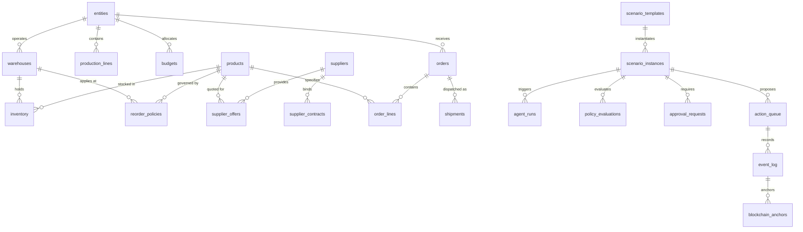

# Enterprise AI Mesh — Database & Dataset Technical Architecture

> **System Component:** Enterprise AI Data & Storage Infrastructure  
> **Primary Database:** PostgreSQL 16+ (Relational & Event Ledger)  
> **Graph Database:** Neo4j 5.18+ (Topology & Disruption Analysis) with Relational Fallback  
> **Source Dataset:** `project_reference/enterprise_ai_industrial_dataset_v2.xlsx` (40 Sheets, 1,677 Rows)  
> **Data Pipeline:** Python Data Pipeline (`backend/data/`) · Versioned SQL Migrations (`backend/db/migrations/`)  
> **Target Enterprise:** Eastern Alloy & Steel (EAS, fictional heavy-industry steel manufacturer)

---

## 1. Executive Summary & Data Architecture Context

The data architecture of the Enterprise AI Mesh is grounded in an industrial manufacturing supply-chain dataset modeled after a Tier-1 integrated steelworks. The data encompasses raw material procurement (iron ore, coking coal, flux), steelmaking (blast furnaces, basic oxygen furnaces, continuous casters), inventory management across distributed distribution centers, customer sales orders, freight dispatch logistics, and plant floor maintenance.

```
┌────────────────────────────────────────────────────────────────────────────────────────┐
│             RAW INDUSTRIAL SOURCE WORKBOOK (40 Sheets, 1,677 Rows)                     │
│                 project_reference/enterprise_ai_industrial_dataset_v2.xlsx             │
└──────────────────────────────────────────┬─────────────────────────────────────────────┘
                                           │
                                           ▼
┌────────────────────────────────────────────────────────────────────────────────────────┐
│                 INSPECTION, MAPPING & VALIDATION PIPELINE (backend/data/)               │
│  ┌──────────────────────┐  ┌───────────────────────┐  ┌─────────────────────────────┐  │
│  │ inspect_workbook.py  │  │  column_mappings.py   │  │ run_validation.py (119 chks)│  │
│  │  Structure Extractor │  │  Type & PK/FK Mapping │  │ Zero-DB Rule Verifier       │  │
│  └──────────────────────┘  └───────────────────────┘  └─────────────────────────────┘  │
└──────────────────────────────────────────┬─────────────────────────────────────────────┘
                                           │
                        ┌──────────────────┴──────────────────┐
                        ▼                                     ▼
┌──────────────────────────────────────────────┐  ┌──────────────────────────────────────┐
│       POSTGRESQL RELATIONAL REPOSITORY       │  │         NEO4J KNOWLEDGE GRAPH        │
│          (backend/db/migrations/)            │  │          (knowledge-graph/)          │
│  ┌────────────────────────────────────────┐  │  ┌───────────────────────────────────┐  │
│  │ 001_operational_schema.sql (22 tables) │  │  │ Node Labels:                      │  │
│  │ 002_runtime_schema.sql (11 tables)     │  │  │  - Customer, Order, Product,     │  │
│  │ 003_workflow_agent_schema.sql (Indexes)│  │  │    Warehouse, Supplier, Shipment  │  │
│  │ 004_scheduler_lifecycle_schema.sql     │  │  │ Relationships:                    │  │
│  │ 005_blockchain_anchoring_schema.sql    │  │  │  - PLACED, CONTAINS, SUPPLIED_BY, │  │
│  │ (33 Total Tables, Foreign Keys, Checks)│  │  │    FULFILLED_FROM, DISPATCHED_VIA │  │
│  └────────────────────────────────────────┘  │  └───────────────────────────────────┘  │
└──────────────────────────────────────────────┘  └──────────────────────────────────────┘
```

---

## 2. Industrial Dataset Deep-Dive (`enterprise_ai_industrial_dataset_v2.xlsx`)

The dataset is located at `project_reference/enterprise_ai_industrial_dataset_v2.xlsx`. It consists of **40 distinct sheets** containing **1,677 total rows**.

### 2.1 Complete Sheet-by-Sheet Inventory & Mapping

| Sheet Name | Destination Table | Source Rows | Primary Key | Classification & Functional Purpose |
| :--- | :--- | :--- | :--- | :--- |
| **`README`** | *None (Metadata)* | 8 | `item` | Dataset provenance, company framing (EAS fictional), and reference notes. |
| **`ref_entities`** | `entities` | 4 | `entity_id` | Legal operating entities (Corporate HQ, Jamshedpur Works, Pune Plant, Hazira Complex). |
| **`ref_departments`** | `departments` | 11 | `department_id` | Operational departments (Procurement, Logistics, Finance, Quality Control, Maintenance). |
| **`ref_products`** | `products` | 11 | `product_id` | Finished products (HR Coils, CR Sheets, Heavy Slabs) and raw materials (Iron Ore, Coking Coal). |
| **`ref_warehouses`** | `warehouses` | 5 | `warehouse_id` | Storage facilities and distribution hubs (Pune Hub, Nagpur DC, Raigad Yard, Bhilai Central). |
| **`ref_suppliers`** | `suppliers` | 8 | `supplier_id` | Qualified industrial vendors (Bharat Heavy, Jindal Industrial, Tata Refractories). |
| **`ref_supplier_offers`** | `supplier_offers` | 6 | `offer_id` | Active vendor spot and contract price quotes for raw materials and spares. |
| **`ref_roles`** | `roles` | 7 | `role_id` | Corporate authorization roles (Admin, Procurement Lead, Finance Approver, Operator). |
| **`ref_users`** | `users` | 30 | `user_id` | Operators, engineers, and supply chain managers mapped to roles and entities. |
| **`ref_production_lines`**| `production_lines` | 5 | `production_line_id` | Primary mill lines (Blast Furnace 1, Continuous Casting 2, Hot Strip Mill 1). |
| **`ref_budgets`** | `budgets` | 4 | `budget_id` | Departmental budget caps, allocated funds, committed spends, and approval thresholds in INR. |
| **`ref_supplier_contracts`**| `supplier_contracts`| 4 | `contract_id` | Long-term master service agreements and statutory spend caps. |
| **`ref_shifts`** | `shifts` | 4 | `shift_id` | Plant shift definitions (Morning, Evening, Night, General) with duration hours. |
| **`ref_reorder_policies`**| `reorder_policies` | 55 | `policy_id` | Reorder points, safety stock minimums, and target stock levels by SKU and warehouse. |
| **`bill_of_materials`** | `bill_of_materials` | 5 | `bom_line_id` | Multi-tier manufacturing BOM recipes (e.g. Iron Ore + Coal ➔ Steel Slab). |
| **`inventory`** | `inventory` | 150 | `inventory_id` | Real-time on-hand, reserved, and available quantities by SKU and warehouse location. |
| **`orders`** | `orders` | 200 | `order_id` | Customer purchase orders with promised delivery dates, status, and priorities. |
| **`order_lines`** | `order_lines` | 200 | `order_line_id` | Line-item product quantities and unit prices linked to parent customer orders. |
| **`production_batches`** | `production_batches`| 60 | `batch_id` | Scheduled and running production runs with planned vs actual output in metric tons. |
| **`shipments`** | `shipments` | 120 | `shipment_id` | Freight dispatch consignments, transport modes (Rail, Road), ETAs, and delay flags. |
| **`purchase_orders`** | `purchase_orders` | 3 | `po_id` | Upstream purchase requisitions dispatched to vendors against sanctioned budgets. |
| **`goods_receipts`** | `goods_receipts` | 2 | `receipt_id` | Inbound gate receipts and quality inspection outcomes (Accepted, Quality Hold). |
| **`quality_events`** | `quality_events` | 40 | `event_id` | Chemical composition, hardness, and tolerance defect logs across batches. |
| **`maintenance_assets`**| `maintenance_assets`| 35 | `asset_id` | Mill plant machinery (Turbines, Compressors, Ladles, Overhead Cranes). |
| **`maintenance_work_orders`**| `maintenance_work_orders`| 50 | `work_order_id` | Planned preventive and emergency breakdown maintenance work orders. |
| **`energy_readings`** | `energy_readings` | 240 | `reading_id` | Smart meter power consumption telemetry (kWh, peak demand, power factor). |
| **`safety_events`** | `safety_events` | 25 | `event_id` | Plant safety incident logs (Near-Miss, Equipment Guard Alerts, PPE alerts). |
| **`carrier_events`** | `carrier_events` | 2 | `event_id` | Intermodal freight milestones and transit delay alerts (weather, checkpoints). |
| **`feed_health`** | `feed_health` | 4 | `feed_id` | External telemetric integration feeds (ERP, SCADA, Rail Freight API, Weather API). |
| **`business_rules`** | `business_rules` | 10 | `rule_id` | Deterministic governance rules (Margin floor, Budget limits, Single-source checks). |
| **`scenario_templates`** | `scenario_templates`| 15 | `scenario_template_id`| Disruption templates (Supplier Unavailable, Budget Overrun, Corrupted Stream). |
| **`simulation_config`** | `simulation_config` | 12 | `config_key` | Global runtime knobs (Cycle intervals, seed randomness, LLM temperature). |
| **`scenario_instances`** | `scenario_instances`| 0 (Runtime) | `scenario_id` | Dynamically generated runtime disruption instances (populated during execution). |
| **`agent_runs`** | `agent_runs` | 0 (Runtime) | `run_id` | Specialist agent execution telemetry, durations, token counts, and outputs. |
| **`decisions`** | `decisions` | 0 (Runtime) | `decision_id` | Supervisor synthesis recommendations, resolved conflicts, and action plans. |
| **`action_queue`** | `action_queue` | 0 (Runtime) | `action_id` | Controlled action proposals undergoing governance, approval, and execution. |
| **`event_log`** | `event_log` | 0 (Runtime) | `event_id` | Chronological audit trail of all workflow stage transitions and state mutations. |
| **`blockchain_anchors`**| `blockchain_anchors`| 0 (Runtime) | `anchor_id` | Cryptographic SHA-256 state commitments anchored to Ethereum Sepolia. |
| **`data_dictionary`** | *None (Metadata)* | 37 | `table_name` | Human-readable documentation of every entity and domain relationship. |
| **`column_dictionary`** | *None (Metadata)* | 305 | `column_name` | Column-level schema definitions, data types, nullability, and field semantics. |

### 2.2 Data Reconciliation Summary
- **Total Rows in Workbook:** `1,677`
- **Mapped Import Rows:** `1,327` across 31 core operational tables.
- **Excluded Metadata Rows:** `350` (`README`: 8 + `data_dictionary`: 37 + `column_dictionary`: 305).
- **Runtime Operational Tables:** `6` tables initialized with schema definitions but 0 seed rows (populated dynamically as workflows run).

### 2.3 Data Quality Anomalies Identified & Handled
During the initial audit, the pipeline identified and corrected several source anomalies via `backend/data/column_mappings.py`:
1. **DQ-01 (Mislabeled Header):** In `scenario_templates`, column `linked_reference_id` actually contained severity strings (`LOW`, `MEDIUM`, `HIGH`, `CRITICAL`). Handled by mapping severity values correctly.
2. **Date Coercion:** Heterogeneous date strings (`YYYY-MM-DD`, `DD/MM/YYYY`, and Excel serial dates) coerced to standard ISO-8601 UTC dates via `_parse_date` and `_parse_datetime`.
3. **Currency Standardization:** Financial quantities expressed in Indian Rupees (INR) stored as `NUMERIC(18, 2)` to avoid floating-point rounding errors.
4. **Referential Integrity Constraints:** Foreign keys strictly ordered into a 31-step topological load sequence to ensure parent entities (e.g. `entities`, `suppliers`, `products`) are fully committed before child tables (`inventory`, `order_lines`, `purchase_orders`).

---

## 3. PostgreSQL Database Schema (`backend/db/migrations/`)

The relational schema is governed by versioned, incremental SQL migration scripts located in `backend/db/migrations/`:

### 3.1 Migration Manifest

```
backend/db/migrations/
├── 001_operational_schema.sql         # 22 master and transactional tables
├── 002_runtime_schema.sql             # 11 orchestration and runtime governance tables
├── 003_workflow_agent_schema.sql      # Performance indices on scenario instances & agent runs
├── 004_scheduler_lifecycle_schema.sql # Distributed scheduler lease lock columns & indexing
└── 005_blockchain_anchoring_schema.sql# Sepolia confirmation timestamps & gas metrics
```

### 3.2 Key Relational Tables & Constraints

#### 1. Core Master Data (`001_operational_schema.sql`)
- **`entities`**: Top-level corporate and manufacturing operating units.
  - *Constraints:* `status IN ('ACTIVE', 'INACTIVE')`
- **`products`**: Finished steel products and raw commodities.
  - *Constraints:* `status IN ('ACTIVE', 'INACTIVE', 'OBSOLETE')`, `reference_unit_cost_inr NUMERIC(18, 2)`
- **`warehouses`**: Storage hubs linked to operating entities.
  - *Constraints:* `entity_id REFERENCES entities(entity_id)`
- **`suppliers`**: Qualified vendors with historical reliability scores.
  - *Constraints:* `risk_band IN ('LOW', 'MEDIUM', 'HIGH')`, `historical_on_time_rate BETWEEN 0 AND 1`
- **`budgets`**: Cost center budgets with single-action threshold limits.
  - *Constraints:* `currency = 'INR'`, `approved_limit_inr >= committed_spend_inr`
- **`reorder_policies`**: Stock parameters by SKU and warehouse.
  - *Constraints:* `UNIQUE(item_id, warehouse_id)`, `reorder_point_qty >= safety_stock_qty`

#### 2. Operational Transactions (`001_operational_schema.sql`)
- **`inventory`**: Real-time warehouse balance ledger.
  - *Constraints:* `stock_signal IN ('NORMAL', 'LOW_STOCK', 'CRITICAL', 'OUT_OF_STOCK', 'EXCESS')`
- **`orders`**: Customer demand orders.
  - *Constraints:* `status IN ('OPEN', 'IN_PROGRESS', 'AT_RISK', 'COMPLETED', 'CANCELLED')`, `priority IN ('LOW', 'MEDIUM', 'HIGH', 'CRITICAL')`
- **`order_lines`**: Itemized lines with requested quantities and unit prices.
  - *Constraints:* `order_id REFERENCES orders(order_id)`, `product_id REFERENCES products(product_id)`
- **`shipments`**: Freight dispatches.
  - *Constraints:* `transport_mode IN ('RAIL', 'ROAD', 'ROAD_RAIL', 'SEA', 'AIR')`

#### 3. Runtime & Governance (`002_runtime_schema.sql` through `005_blockchain_anchoring_schema.sql`)
- **`scenario_instances`**: Disruption instances injected into the system.
  - *Constraints:* `status IN ('QUEUED', 'RUNNING', 'WAITING_APPROVAL', 'RESOLVED', 'REJECTED', 'FAILED')`
- **`agent_runs`**: Telemetry and execution outputs for specialist agents.
  - *Fields:* `agent_name`, `phase`, `status`, `duration_ms`, `tokens_used`, `deterministic_output`, `llm_recommendation`
- **`policy_evaluations`**: Record of deterministic business rule checks.
  - *Fields:* `rule_id`, `status` (`PASS`/`FAIL`), `input_values`, `threshold_value`
- **`approval_requests`**: Human-in-the-Loop authorization gates.
  - *Fields:* `required_role`, `status` (`PENDING`, `APPROVED`, `REJECTED`), `reason`, `decided_by`, `decided_at`
- **`action_queue`**: Controlled actions proposed by agents.
  - *Fields:* `action_type`, `payload`, `status` (`PROPOSED`, `APPROVED`, `EXECUTED`, `FAILED`), `idempotency_key`
- **`event_log`**: Immutable audit log of all system state changes.
  - *Fields:* `event_type`, `actor_id`, `order_id`, `payload_hash`, `timestamp`
- **`blockchain_anchors`**: Cryptographic proofs anchored on Ethereum Sepolia.
  - *Fields:* `event_id_or_batch_id`, `payload_hash`, `transaction_hash`, `block_number`, `gas_used`, `confirmation_status`

---

## 4. Entity-Relationship Architecture



---

## 5. Data Pipeline & Validation Tooling (`backend/data/`)

The data pipeline guarantees that the database is loaded with zero data loss, exact type coercion, and strict referential validation.

### 5.1 Pipeline Script Inventory

```
backend/data/
├── column_mappings.py          # Authoritative mapping specifications & load order
├── inspect_workbook.py         # Structural analysis of sheets, column types & null counts
├── validators.py               # 12 standalone data constraint validation functions
├── run_validation.py           # Zero-database standalone validation script
├── load_seed_data.py           # Idempotent database seed loader
└── validate_seed_data.py       # Post-migration database-to-workbook audit script
```

### 5.2 Standalone Validation Rules (`validators.py`)
`run_validation.py` executes 119 rule checks across the 31 mapped sheets without requiring a live database connection:
- **`check_no_duplicate_ids`**: Verifies primary key uniqueness across all rows.
- **`check_no_nulls`**: Enforces strict non-nullability on required columns.
- **`check_referential_integrity`**: Validates foreign key parent-child relationships across sheets.
- **`check_valid_status`**: Enforces enum allowlists on all status, risk, and severity fields.
- **`check_date_order`**: Asserts chronological validity (e.g. `effective_from <= effective_to`, `planned_start <= planned_end`).
- **`check_numeric_range`**: Asserts that percentages and rates lie within `[0.0, 1.0]` and costs are strictly non-negative.
- **`check_arithmetic_identity`**: Enforces balance equations (e.g. `on_hand_qty - reserved_qty == available_qty`, `approved_limit_inr - committed_spend_inr == available_budget_inr`).

*Validation Outcome:* **119 of 119 checks PASS** (documented in `backend/data/validation_report.json`).

### 5.3 Idempotent Bulk Loader (`load_seed_data.py`)
- Employs `INSERT ... ON CONFLICT (primary_key) DO NOTHING`.
- Safely rerun without overwriting live transactional records or corrupting sequences.
- Topological execution sequence ensures zero foreign-key constraint violations during loading.

---

## 6. Knowledge Graph Engine (Neo4j & Relational Fallback)

The Knowledge Graph represents the multi-tier supply chain topology, material dependencies, and disruption blast-radii.

### 6.1 Cypher Schema (`knowledge-graph/schema.cypher`)

```cypher
// Node Labels & Unique Constraints
CREATE CONSTRAINT FOR (c:Customer) REQUIRE c.id IS UNIQUE;
CREATE CONSTRAINT FOR (o:Order) REQUIRE o.id IS UNIQUE;
CREATE CONSTRAINT FOR (p:Product) REQUIRE p.id IS UNIQUE;
CREATE CONSTRAINT FOR (w:Warehouse) REQUIRE w.id IS UNIQUE;
CREATE CONSTRAINT FOR (s:Supplier) REQUIRE s.id IS UNIQUE;
CREATE CONSTRAINT FOR (shp:Shipment) REQUIRE shp.id IS UNIQUE;

// Canonical Relationships
(Customer)-[:PLACED]->(Order)
(Order)-[:CONTAINS]->(Product)
(Product)-[:SUPPLIED_BY]->(Supplier)
(Order)-[:FULFILLED_FROM]->(Warehouse)
(Order)-[:DISPATCHED_VIA]->(Shipment)
(Shipment)-[:ORIGINATES_AT]->(Warehouse)
(Shipment)-[:DESTINED_FOR]->(Warehouse)
```

### 6.2 Relational Fallback Engine (`graph_service.py`)
When a physical Neo4j instance is unavailable (`NEO4J_URI` unreachable or offline):
- The `RelationalGraphEngine` automatically engages without crashing the API.
- Generates dynamic topological graphs directly from PostgreSQL `orders`, `order_lines`, `products`, `warehouses`, and `suppliers` tables.
- Traverses disruption blast-radii using recursive Common Table Expressions (CTEs) or in-memory BFS graphs.
- Truthfully reports its operational state as `"Relational fallback"` to the frontend control room.

---

## 7. Database Administration & Operational Commands

### 7.1 Running Migrations & Seeding
```powershell
# 1. Inspect migration status (dry-run)
python backend/db/migrate.py --dry-run

# 2. Execute pending versioned migrations
python backend/db/migrate.py

# 3. Load seed data idempotently
python backend/data/load_seed_data.py

# 4. Validate loaded records against original workbook
python backend/data/validate_seed_data.py
```

### 7.2 Database Verification Queries
To verify system state directly in PostgreSQL:

```sql
-- Check migration ledger
SELECT version, filename, applied_at, checksum FROM _schema_migrations ORDER BY version;

-- Check inventory balances and signals
SELECT item_id, warehouse_id, on_hand_qty, reserved_qty, available_qty, stock_signal 
FROM inventory 
WHERE stock_signal != 'NORMAL';

-- Check pending approval requests
SELECT approval_id, scenario_id, required_role, status, reason, requested_at 
FROM approval_requests 
WHERE status = 'PENDING';

-- Check cryptographic blockchain anchor commitments
SELECT anchor_id, event_id_or_batch_id, payload_hash, transaction_hash, confirmation_status, confirmed_at 
FROM blockchain_anchors 
ORDER BY submitted_at DESC LIMIT 10;
```
