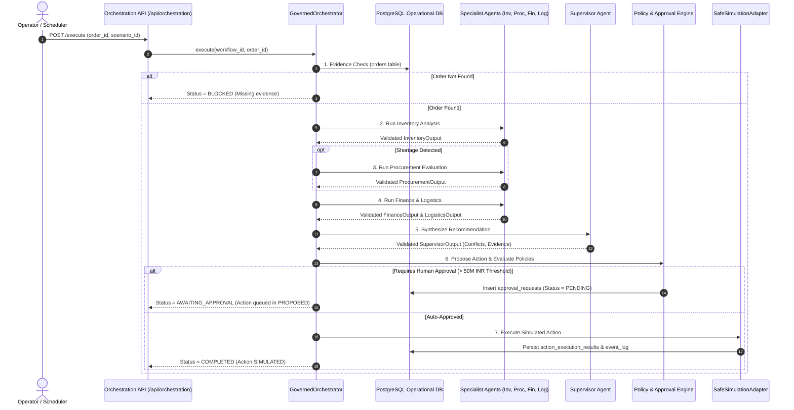

# Enterprise AI Mesh — Phase 4 Implementation & Verification Report

**Phase:** Phase 4: Governed Multi-Agent Intelligence and Orchestration  
**Status:** Completed, Hardened & Verified  
**Date:** 14 October 2026  
**Repository:** `D:\MajorProject\EnterpriseAI`  

---

## 1. Initial State & Baseline

Phase 4 took over from a partially completed state where the previous model exhausted quota. The initial inspection established:
- **Baseline Test Suite:** 182 passing tests before Phase 4.
- **Operational Data Integrity:** 1,327 seed records across 31 PostgreSQL domain tables fully preserved.
- **Initial Partial Files:**
  - `backend/app/main.py`: Updated with `/api/orchestration` router registration.
  - `backend/app/api/orchestration.py`: Preliminary router with route collisions on UUID parsing (`/providers` vs `/{workflow_id}`).
  - `backend/app/core/llm_provider.py`: Skeleton provider abstraction without bounded timeouts, retry logic, credential masking, or typed response validation.
  - `backend/app/orchestration/governed.py`: Orchestration harness missing full specialist validation, supervisor synthesis, policy evaluation, approval gating, and retry/resume lifecycle.
  - `backend/tests/test_orchestration.py`: Initial test cases requiring alignment with operational seed database IDs and 50M INR single-action threshold limits.
  - `frontend/src/App.tsx` & `Sidebar.tsx`: Navigation entries added for Orchestration.
  - `frontend/src/pages/OrchestrationPage.tsx`: Preliminary UI with broken DemoContext access (`isLive` vs `dataMode === 'live' && isLiveConnected`).
  - `frontend/src/services/apiClient.ts`: Preliminary types lacking retry and comprehensive governance fields.

---

## 2. Implemented & Hardened Files

The following files were created, corrected, and integrated:

1. **`backend/app/core/llm_provider.py`**:
   - `LLMProvider` abstract interface with `SimulationProvider` and `LiveProvider` implementations.
   - Strict execution modes: `SIMULATION` (deterministic local synthesis) and `LIVE` (HTTP provider consultation).
   - Typed error hierarchy: `LLMProviderError`, `LLMProviderUnavailableError`, `LLMProviderTimeoutError`, `LLMProviderMalformedOutputError`, `LLMProviderConfigError`.
   - Bounded timeouts (1–60 seconds) and retries (0–3 attempts with exponential backoff) using `httpx.Client`.
   - Credential redaction in logs: keys formatted as `sk-t...123` with sensitive prompt payloads and tokens masked.
   - Response validation: structured JSON parsed against `AgentResponse` contract; malformed or missing payloads reject immediately (fail-closed, zero hallucinated successes).

2. **`backend/app/models/agent_contracts.py`**:
   - Extended `SupervisorOutput` contract with `conflicts: List[str]`, `missing_evidence: List[str]`, and `proposed_next_step: Optional[str]`.
   - Complete Pydantic models for `InventoryOutput`, `ProcurementOutput`, `FinanceOutput`, `LogisticsOutput`, and `AgentResponse`.

3. **`backend/app/agents/supervisor.py`**:
   - Grounded specialist synthesis evaluating inventory shortages, supplier selection, finance checks, and route status.
   - Deterministic conflict detection (e.g., shortages without supplier offers, spend exceeding budgets, route delays, quality holds).
   - Operational evidence verification and next-step proposal (`RESOLVE_CONFLICTS_OR_ESCALATE`, `REQUEST_HUMAN_APPROVAL`, `PROPOSE_AND_EXECUTE_ACTION`).
   - Durable persistence into the PostgreSQL `decisions` table.

4. **`backend/app/agents/inventory.py`**:
   - Grounded stock checks against `orders`, `order_lines`, and `inventory` tables.
   - Respects scenario `input_overlay` for deterministic simulation overrides while preserving real database records.

5. **`backend/app/orchestration/governed.py`**:
   - End-to-end `GovernedOrchestrator` execution:
     1. **Correlation & Operational Evidence Check**: Verifies order exists in PostgreSQL; missing orders transition workflow to `BLOCKED`.
     2. **Specialist Agent Execution**: Runs `InventoryAgent`, conditional `ProcurementAgent` (skipped if inventory has sufficient stock), `FinanceAgent`, and `LogisticsAgent` with typed contract validation at every step.
     3. **Supervisor Synthesis**: Generates recommendation, conflicts, missing evidence, and proposed action.
     4. **Deterministic Policy Gating**: Evaluates proposed action through `propose_action` in `action_service.py` against active business rules in PostgreSQL.
     5. **Approval Enforcement**: If single-action approval threshold (> 50,000,000 INR) is breached, records pending request in `approval_requests` and transitions workflow to `AWAITING_APPROVAL` (`WAITING_APPROVAL` in DB).
     6. **Safe Simulation Execution**: If approved, invokes `execute_action` using `SafeSimulationAdapter`.
     7. **Watchdog Retry & Resume**: Full `retry(workflow_id, conn)` method enabling safe retry of failed workflows or resumption of approved workflows.

6. **`backend/app/api/orchestration.py`**:
   - Secured FastAPI router mounted under `/api/orchestration`:
     - `POST /execute` & `POST /{workflow_id}/run` (Requires `OPERATOR` role).
     - `POST /{workflow_id}/retry` (Requires `OPERATOR` role).
     - `GET /{workflow_id}`, `GET /{workflow_id}/agents`, `GET /{workflow_id}/governance` (Requires `VIEWER` role).
     - `GET /providers` (Requires `VIEWER` role, ordered before parameterized `{workflow_id}` path).
   - Validates request payloads and prevents identity or status spoofing.

7. **`frontend/src/services/apiClient.ts`**:
   - Added typed methods: `executeOrchestration`, `runOrchestration`, `retryOrchestration`, `getOrchestration`, `getWorkflowAgents`, `getWorkflowGovernance`, and `getOrchestrationProviders`.
   - Updated `OrchestrationResult` model matching backend response contracts.

8. **`frontend/src/pages/OrchestrationPage.tsx`**:
   - Fixed `useDemo()` dataMode check (`dataMode === 'live' && isLiveConnected`).
   - Interactive control room displaying live/simulation provider badge, specialist-agent cards, supervisor findings, detected conflicts, missing evidence alerts, simulated action outcome, and retry/resume controls.

9. **`backend/tests/test_orchestration.py`**:
   - 36 comprehensive test cases covering simulation mode, live provider timeouts, malformed output rejection, credential masking, specialist validation, missing evidence blocking, approval thresholds, RBAC, idempotency, and audit trails.

---

## 3. Orchestration Sequence & Agent Contracts

---

## 4. Provider Configuration & Simulation Behavior

- **Execution Modes**:
  - `SIMULATION`: Deterministic, air-gapped synthesis grounded exclusively in PostgreSQL operational tables. Enabled by default (`APP_ENVIRONMENT != production` or `LLM_PROVIDER_MODE=simulation`).
  - `LIVE`: Requires valid `LLM_PROVIDER_API_KEY` and endpoints. Enforces strict timeouts (default 15s) and retries (2 attempts). If live provider is unavailable or produces invalid JSON, fails closed with clear error reporting and zero hallucinated progress.
- **Safe Credential Handling**:
  - Masked log outputs (`sk-t...123`).
  - Raw tokens, keys, and confidential context are never written to disk or logs.

---

## 5. API Endpoints & Authorization

| Method | Endpoint | Required Role | Description |
|---|---|---|---|
| `POST` | `/api/orchestration/execute` | `OPERATOR` | Start a new governed orchestration workflow |
| `POST` | `/api/orchestration/{workflow_id}/run` | `OPERATOR` | Run governed orchestration on existing scenario |
| `POST` | `/api/orchestration/{workflow_id}/retry` | `OPERATOR` | Retry failed run or resume approved run |
| `GET` | `/api/orchestration/{workflow_id}` | `VIEWER` | Retrieve workflow execution status and results |
| `GET` | `/api/orchestration/{workflow_id}/agents` | `VIEWER` | Retrieve individual agent execution steps |
| `GET` | `/api/orchestration/{workflow_id}/governance` | `VIEWER` | Retrieve policy evaluations and approval status |
| `GET` | `/api/orchestration/providers` | `VIEWER` | Inspect provider mode, model, and capabilities |

---

## 6. Verification Results

### 6.1 Backend Test Suite
- **Command:** `python -m pytest -q`
- **Result:** **218 passed in 21.31s** (100% PASS, 0 failures, 0 regressions).
- **Targeted Orchestration Tests:** `python -m pytest tests/test_orchestration.py -v` -> **36 passed in 6.64s**.
- **Scheduler & Security Tests:** `python -m pytest tests/test_scheduler.py tests/test_security.py -v` -> **35 passed in 7.09s**.
- **E2E Lifecycle & Actions Tests:** `python -m pytest tests/test_e2e_lifecycle.py tests/test_action_execution.py tests/test_policy_engine.py -v` -> **20 passed in 4.33s**.

### 6.2 Operational Seed Data Validation
- **Command:** `python backend/data/validate_seed_data.py --database-url-var TEST_DATABASE_URL`
- **Result:**
  - `database_queried`: `True`
  - `total_checks`: `119`
  - `passed_checks`: `119`
  - `failed_checks`: `0`
  - `pass`: `True`
- **Integrity:** Exactly 1,327 seed rows across 31 tables verified unchanged.

### 6.3 Runtime Table Isolation
- **Command:** `python -m pytest tests/test_isolation.py -v`
- **Result:** **4 passed in 0.40s**.
- Ephemeral test executions in runtime tables (`scenario_instances`, `event_log`, `agent_runs`, etc.) isolated and cleaned without touching domain seed data.

### 6.4 Frontend Build & Lint
- **Command:** `npm run build` in `frontend/`
  - **Result:** **Built in 1.50s** (0 errors, dist files generated successfully).
- **Command:** `npm run lint` in `frontend/`
  - **Result:** **0 errors**, 1 harmless Fast Refresh warning in `DemoContext.tsx`.

### 6.5 Docker Compose Syntax Validation
- **Command:** `docker compose config` with safe interpolation placeholders.
- **Result:** **Exit code 0** (Valid specification with fail-closed security for unconfigured production keys).
- **Distinction:** Configuration syntax validation confirms interpolation and container definitions, but is distinct from live multi-container execution.

### 6.6 Git Formatting Check
- **Command:** `git diff --check`
- **Result:** **Exit code 0** (No whitespace or formatting defects).

---

## 7. Remaining Limitations & Boundaries

1. **Simulated Action Execution**: All external operational interventions (PO creation, route re-dispatch) are executed via `SafeSimulationAdapter` and recorded as simulated events. Live ERP or SAP integration requires real enterprise connectors.
2. **Blockchain Submission**: Cryptographic hashing and verification use canonical SHA-256. Public Ethereum/Polygon network anchoring remains simulated in the local environment until external Web3 RPC credentials and gas funds are provided (planned Phase 7/8).
3. **Live LLM Endpoint**: Tested under local simulation mode and mocked provider unit tests. Live OpenAI/Anthropic network calls were not performed during ordinary test runs to maintain deterministic, air-gapped guarantees.
